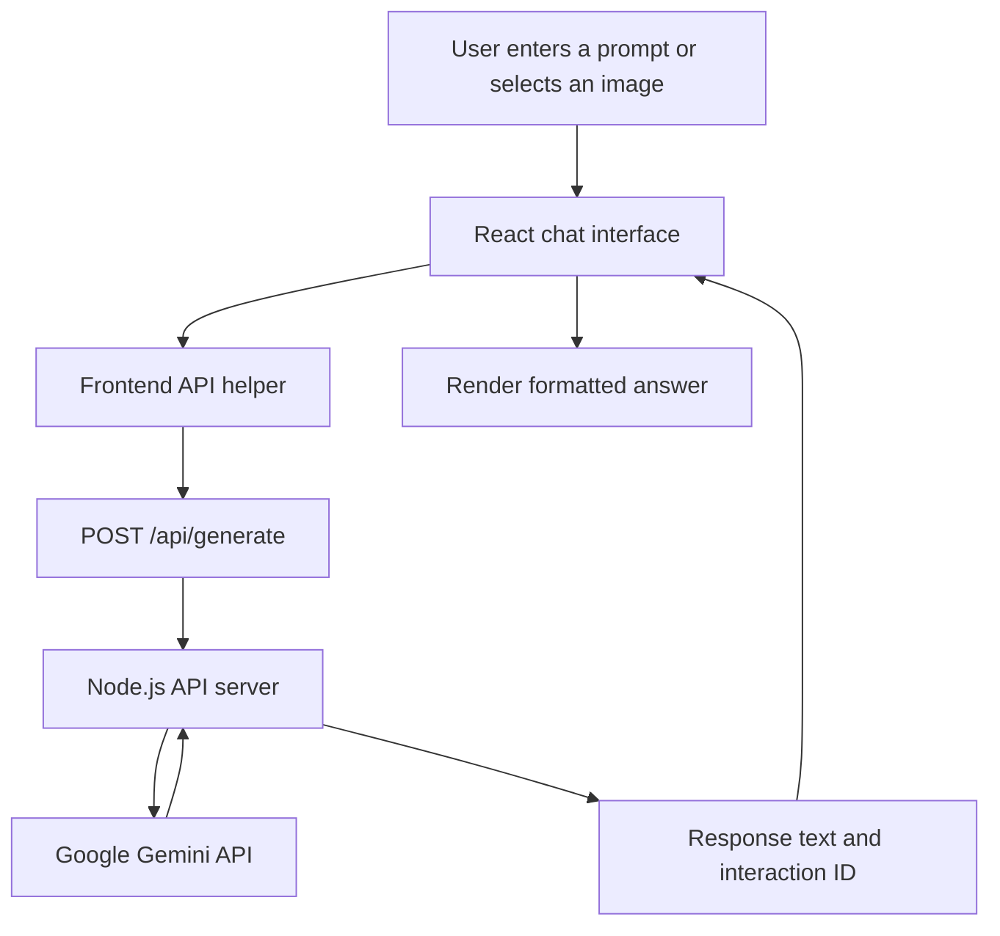
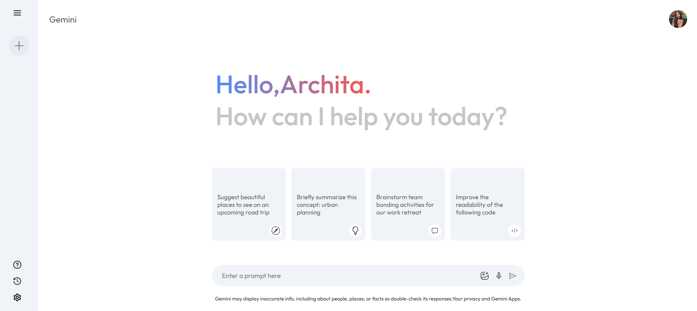

# Gemini Clone

A Gemini-inspired Generative AI chat application built with **React**, **Vite**, and Google's **Gemini API**. It provides a conversational interface for text prompts and image questions, with follow-up context, prompt suggestions, voice input, and light/dark themes.

> This is an independent learning project inspired by the Gemini chat experience. It is not an official Google product.

## Table of Contents

- [Overview](#overview)
- [Features](#features)
- [Technology Stack](#technology-stack)
- [How It Works](#how-it-works)
- [Screenshots](#screenshots)
- [Project Structure](#project-structure)
- [Getting Started](#getting-started)
- [Environment Variables](#environment-variables)
- [Available Scripts](#available-scripts)
- [API Endpoints](#api-endpoints)
- [Privacy and Security](#privacy-and-security)
- [Known Requirements and Limitations](#known-requirements-and-limitations)
- [Acknowledgements](#acknowledgements)

## Overview

Gemini Clone lets users send questions and prompts to Google's Gemini model and view the generated answers in a clean chat interface. The interface includes suggested prompts for getting started, a collapsible sidebar for recent prompts, and controls for image and voice input.

The frontend is built with React and communicates with a small Node.js API server. The API server calls Gemini, keeping the API key on the server rather than exposing it in the browser bundle.

## Features

- **AI-powered chat** — submit natural-language prompts and receive Gemini-generated responses.
- **Follow-up conversations** — continue a conversation using the previous Gemini interaction ID; choose **New Chat** to reset the current conversation context.
- **Suggested prompts** — start quickly with example prompts on the home screen.
- **Recent prompt activity** — revisit prompts from the current app session using the sidebar.
- **Image input** — upload JPEG, PNG, WebP, or GIF images up to 5 MB and ask Gemini about them.
- **Voice input** — dictate prompts using browser speech recognition where supported.
- **Loading and error states** — see when a response is being generated and receive readable error messages if a request fails.
- **Markdown response rendering** — display formatted AI responses.
- **Light and dark themes** — switch appearance in Settings; the selected theme is saved in the current browser.
- **Help and settings panels** — access usage tips, recent activity, and appearance preferences.

## Technology Stack

| Technology | Purpose |
| --- | --- |
| React | Builds the interactive, component-based user interface. |
| JavaScript (ES modules) | Implements application logic and API communication. |
| Vite | Provides the development server and production build tooling. |
| CSS | Styles the chat layout, sidebar, themes, and responsive interface. |
| Node.js | Runs the backend API server. |
| Google Gen AI SDK (`@google/genai`) | Sends prompts and image input to Google's Gemini API. |
| Google Gemini API | Generates AI responses and supports image understanding. |
| `marked` | Converts Markdown-formatted responses into HTML for display. |
| `dotenv` | Loads local environment variables from `.env`. |
| ESLint | Helps identify code-quality and style issues. |

## How It Works



1. The user enters a prompt, chooses a suggested prompt, or attaches a supported image.
2. The React frontend sends the request to the local `/api/generate` endpoint.
3. The Node.js server reads the Gemini API key from its environment and calls the configured Gemini model.
4. The server returns the generated response and an interaction ID.
5. The frontend renders the answer and retains the interaction ID for follow-up prompts in the same chat.

The default model is `gemini-3.1-flash-lite`. You can change it with the `GEMINI_MODEL` environment variable if another model is available to your Google AI Studio project.

## Screenshots

Screenshots are not currently included in the repository. Add genuine screenshots of the running application to `docs/images/`, then embed them here. Suggested screenshots:

- Main screen with suggested prompts
- Chat conversation showing a generated response
- Sidebar showing recent prompts
- Settings panel with light and dark theme options
- Image or voice input (if you want to demonstrate these features)

For example, after adding a screenshot at `docs/images/main-screen.png`, embed it with:

```markdown

```

## Project Structure

```text
Gemini-clone/
├── public/                     # Public static assets
├── src/
│   ├── assets/                 # Icons and image assets
│   ├── components/
│   │   ├── Main/               # Main chat UI and prompt input
│   │   └── Sidebar/            # Navigation, recent prompts, help, settings
│   ├── config/
│   │   └── gemini.js           # Frontend helper for the local API
│   ├── context/
│   │   ├── Context.js          # React context definition
│   │   └── context.jsx         # Shared chat state and request handling
│   ├── App.jsx                 # App component composition
│   ├── index.css               # Global styles
│   └── main.jsx                # React entry point
├── dev.js                      # Starts API and Vite for local development
├── server.js                   # Node.js API server for Gemini requests
├── index.html                  # HTML entry point
├── package.json                # Dependencies and npm scripts
├── package-lock.json           # Locked dependency versions
├── vite.config.js              # Vite configuration and API proxy
└── eslint.config.js             # ESLint configuration
```

## Getting Started

### Prerequisites

Install the following before running the project:

- **Node.js** — use a version supported by Vite 7 (Node.js 20.19+ or 22.12+ recommended).
- **npm** — included with Node.js.
- **Google Gemini API key** — create one in [Google AI Studio](https://aistudio.google.com/apikey).

### 1. Clone the repository

```bash
git clone https://github.com/archita2505/Gemini-clone.git
cd Gemini-clone
```

### 2. Install dependencies

```bash
npm install
```

### 3. Configure environment variables

Create a file named `.env` in the project root and add your own API key:

```dotenv
GEMINI_API_KEY=your_gemini_api_key_here
# Optional: choose a model available to your Google AI Studio project
GEMINI_MODEL=gemini-3.1-flash-lite
# Optional: change the local API port (default: 3001)
API_PORT=3001
```

Replace `your_gemini_api_key_here` with your actual key. Do not commit `.env` or share your API key. The repository's `.gitignore` excludes environment files.

### 4. Start the application

```bash
npm run dev
```

This command starts the Node.js API server and the Vite development server. Open the local URL printed by Vite in the terminal (usually `http://localhost:5173`). If that port is already in use, Vite may print a different URL.

### 5. Create a production build

```bash
npm run build
```

To preview the built frontend locally:

```bash
npm run preview
```

## Environment Variables

| Variable | Required | Default | Description |
| --- | --- | --- | --- |
| `GEMINI_API_KEY` | Yes | — | API key used by the Node.js server to authenticate with Google Gemini. |
| `GEMINI_MODEL` | No | `gemini-3.1-flash-lite` | Gemini model used to generate responses. |
| `API_PORT` | No | `3001` | Port used by the local API server. |

The local development launcher selects an available API port if the default is occupied and configures Vite to proxy `/api` requests to it.

## Available Scripts

| Command | Description |
| --- | --- |
| `npm run dev` | Starts the API server and Vite development server for local development. |
| `npm run build` | Builds the frontend for production in the `dist/` directory. |
| `npm run preview` | Serves the production build locally for preview. |
| `npm run lint` | Runs ESLint checks. |
| `npm run start:api` | Starts only the Node.js API server. |

## API Endpoints

| Method | Endpoint | Description |
| --- | --- | --- |
| `GET` | `/api/health` | Returns a simple health status for the API server. |
| `POST` | `/api/generate` | Sends a prompt and optional image to Gemini and returns the generated text plus an interaction ID. |

The generate endpoint accepts a JSON body containing `prompt`, an optional `previousInteractionId`, and an optional `image` object with base64-encoded image data and its MIME type. The server validates the request and accepts JPEG, PNG, WebP, and GIF images up to 5 MB.

## Privacy and Security

- Keep `GEMINI_API_KEY` in the server-side `.env` file or your hosting provider's server environment variables. Never place the secret in frontend code or commit it to Git.
- If a key is accidentally published, revoke it in Google AI Studio and replace it.
- The app uses Google's Interactions API with `store: true` so a later prompt can refer to the previous interaction. Google may store interaction data according to the applicable Gemini API terms and data-retention policies. Review those policies and avoid submitting sensitive or confidential information.
- Voice input uses the browser's speech-recognition capability and may require microphone permission. Browser support varies.
- API availability and usage limits depend on the model, API key, Google AI Studio project, and applicable quota.

## Known Requirements and Limitations

- An active, valid Gemini API key and an available model quota are required for AI responses.
- Image uploads are limited to JPEG, PNG, WebP, and GIF files up to 5 MB.
- Voice input requires a browser that supports the Web Speech API; Chrome or Edge may work depending on the environment.
- Recent prompts and the current conversation are maintained in application state; the theme preference is saved in the current browser. This project does not currently provide user accounts or a database-backed chat history.
- For deployment, the frontend and Node.js API server must both be hosted and the frontend host must route `/api` requests to the API server. A static frontend deployment alone will not run `server.js`; configure an appropriate backend host or adapt the API to your deployment platform's serverless format.

## Acknowledgements

- [Google AI Studio](https://aistudio.google.com/) for Gemini API access.
- [React](https://react.dev/) for the UI library.
- [Vite](https://vite.dev/) for frontend development and build tooling.
- Inspired by a step-by-step Gemini Clone tutorial by [GreatStack](https://www.youtube.com/watch?v=0yboGn8errU).

